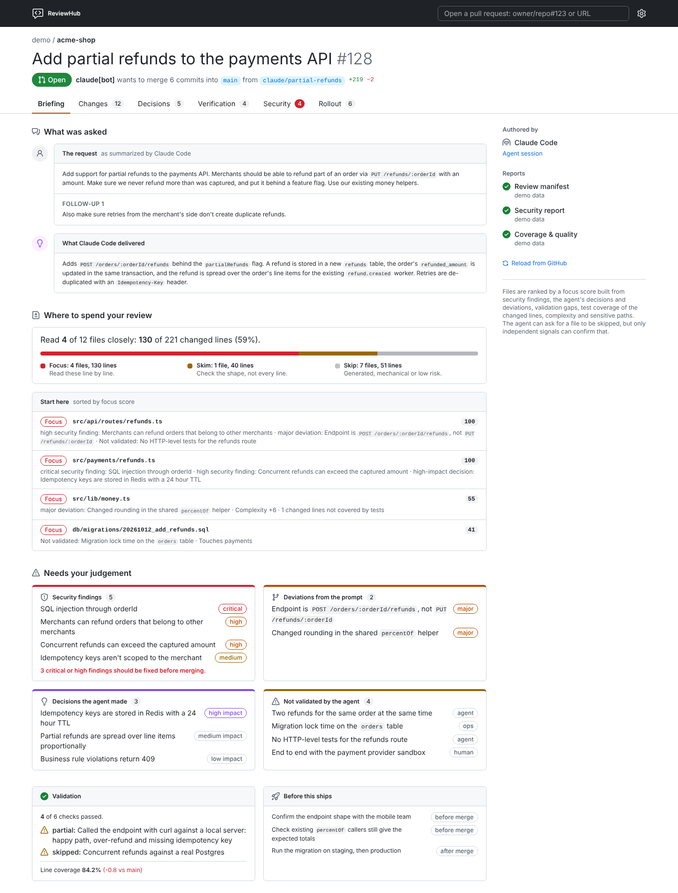
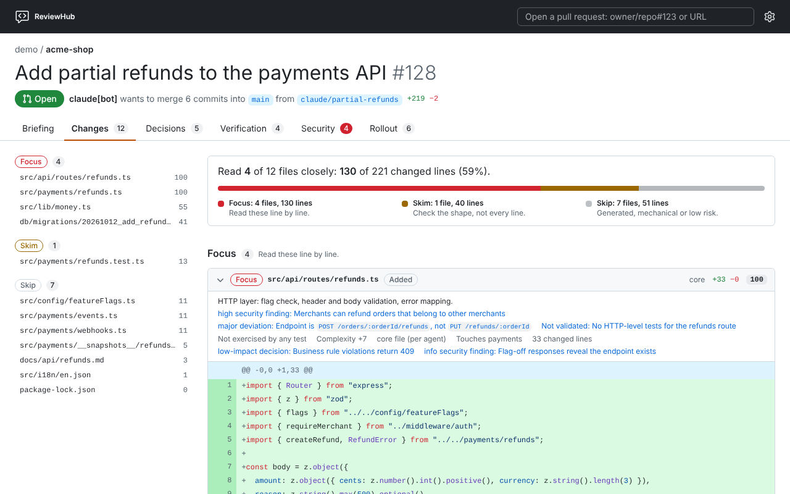
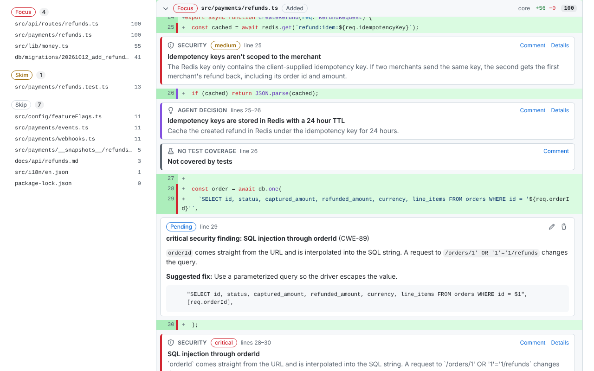

<p align="center">
  
</p>

<h1 align="center">ReviewHub</h1>

<p align="center">
  <strong>Your agents write the code. Review what matters.</strong>
</p>

<p align="center">
  <a href="https://chromewebstore.google.com/detail/reviewhub/eoejgblmpnccaaohifkeajpblaidgnjo">Chrome extension</a> ·
  <a href="https://wearethefoos.github.io/ReviewHub/">Website</a> ·
  <a href="https://wearethefoos.github.io/ReviewHub/review.html?demo">Live demo</a> ·
  <a href="#claude-code-plugin">Claude Code plugin</a> ·
  <a href="#cli-on-its-own">CLI</a>
</p>

<p align="center">
  <a href="https://github.com/wearethefoos/ReviewHub/releases/latest"></a>
  <a href="https://chromewebstore.google.com/detail/reviewhub/eoejgblmpnccaaohifkeajpblaidgnjo"></a>
  <a href="LICENSE"></a>
</p>

Coding agents open pull requests faster than anyone can read them, and most of each diff doesn't need a human. **ReviewHub opens an agent's pull request with its own account of the work and an independent check of it**, then ranks every file so you read the few that matter.

On the demo pull request that means **reading 4 of 12 files closely** (130 of 221 changed lines), with the SQL injection, the missing ownership check and the shared helper the agent quietly changed right at the top.

<picture>
  <source media="(prefers-color-scheme: dark)" srcset="docs/screenshots/briefing-full-dark.png">
  
</picture>

## What you get

**🧭 The briefing.** What was asked next to what was delivered, every **deviation** from the request, every **decision** the prompt left open (with the rejected alternatives and a ready-to-run prompt to switch), the checks the agent **actually ran** with their output, and what it **couldn't validate**, with steps to close each gap.

**🎯 Focus, Skim, Skip.** Security findings, deviations, decisions, gaps, test coverage of the changed lines, complexity and sensitive paths add up to a focus score per file. The diff opens on the Focus files and collapses the generated and mechanical ones. The agent can ask for a file to be skipped; only independent signals can confirm it.

<picture>
  <source media="(prefers-color-scheme: dark)" srcset="docs/screenshots/changes-dark.png">
  
</picture>

**🛡️ An independent security review.** A second agent that never saw the author's conversation reviews the pull request, and every finding comes with a patch or a prompt to fix it. It runs [in CI, in the agent's own session, or on `git push`](#security-reviews), whichever you have set up.

**✍️ Review without leaving.** Comment on a line or drag over several, turn any finding into a review comment with its fix as a one-click GitHub suggestion, and submit **Comment**, **Approve** or **Request changes** in one go. Syntax highlighting and dark mode included.

<picture>
  <source media="(prefers-color-scheme: dark)" srcset="docs/screenshots/review-dark.png">
  
</picture>

**📊 Coverage and complexity from CI.** `reviewhub init` detects Rust, JavaScript/TypeScript and Python test stacks and publishes which changed lines no test runs, and how much more complex each file got. No secrets needed.

**📱 Review from anywhere.** The Chrome extension adds **Open in ReviewHub** to every pull request. The same page runs as a [web app](https://wearethefoos.github.io/ReviewHub/review.html?demo) on your phone, every pull request gets a briefing comment that reads well in the GitHub mobile app, and the Claude Code plugin and CLI bring the briefing to your session and terminal.

**🔒 Nothing hosted, nothing leaked.** Your browser talks to GitHub directly, and your token never leaves your device. Agents summarize prompts instead of quoting them, and any report containing something credential-shaped (GitHub, AWS, Anthropic, OpenAI or Stripe keys, private keys, …) is rejected before it's posted.

**⚖️ No agent grades its own work.** Three reports from three authors: the **review manifest** from the authoring agent, the **security report** from a separate reviewer, and **coverage and complexity** from your CI. ReviewHub only reads reports from people with write access, the pull request's author and logins you trust.

## Get started

**1. Set up a repository** (run in its root, then commit what it lists):

```sh
curl -fsSL https://raw.githubusercontent.com/wearethefoos/ReviewHub/main/install.sh | sh -s -- init
```

From then on, Claude Code publishes a review manifest with every pull request it opens (also in cloud sessions started from your phone), each pull request gets a security review, CI publishes coverage and complexity, and reviewers get a briefing comment.

**2. Review** wherever you are:

| Where | How |
| --- | --- |
| Chrome | [Add ReviewHub to Chrome](https://chromewebstore.google.com/detail/reviewhub/eoejgblmpnccaaohifkeajpblaidgnjo) and click **Open in ReviewHub** on a pull request ([guide](docs/extension.md)) |
| Phone or any browser | [The web app](https://wearethefoos.github.io/ReviewHub/review.html), or the briefing comment on the pull request |
| Claude Code | `/plugin marketplace add wearethefoos/ReviewHub`, `/plugin install reviewhub@reviewhub`, then `/reviewhub:review owner/repo#123` |
| Terminal | `reviewhub review owner/repo#123`, with `--diff` for the Focus files (installed by the command above) |

Want to see it first? Open the [live demo](https://wearethefoos.github.io/ReviewHub/review.html?demo): an agent-authored pull request with every report filled in, no token needed.

## Install

### Chrome extension

Install [ReviewHub from the Chrome Web Store](https://chromewebstore.google.com/detail/reviewhub/eoejgblmpnccaaohifkeajpblaidgnjo). It works in Chrome and other Chromium browsers (Edge, Brave, Arc), and updates itself.

Then:

- Click **Open in ReviewHub** on any pull request on github.com, or the toolbar button while on one.
- For private repositories, and a higher rate limit than GitHub's 60 anonymous requests an hour, add a fine-grained token with read-only *Pull requests* and *Contents* access in the extension's settings. It stays in your browser and is only sent to `api.github.com`.
- The extension's start page has a demo pull request that needs no token.

See [`docs/extension.md`](docs/extension.md) for installing from a release zip instead, the token, what each tab shows and troubleshooting.

### On your phone

- **The briefing comment.** Repositories set up with `reviewhub init` get a workflow that keeps one ReviewHub comment on every pull request: blockers, deviations, decisions, what wasn't validated and which files to read, with links into the diff. It reads well in the GitHub mobile app.
- **The web app** at <https://wearethefoos.github.io/ReviewHub/review.html> is the extension's review page as a static site (the briefing comment links to it). Add it to your home screen. Public repositories work without a token; for private ones, add a token in its settings. The token stays in that browser tab unless you choose to remember it.
- **Claude Code from the Claude app** (cloud sessions) can't install plugins, so `reviewhub init` puts the plugin's skills, subagent and hooks into the repository itself. See [Repository setup](#repository-setup-reviewhub-init).

### Claude Code plugin

```
/plugin marketplace add wearethefoos/ReviewHub
/plugin install reviewhub@reviewhub
```

- `/reviewhub:review owner/repo#123`: a briefing on the pull request in your session, then a walk through what needs your judgement.
- `/reviewhub:security-review owner/repo#123`: an independent security review by a subagent, published as a PR comment.
- `reviewhub:review-manifest`: Claude writes and publishes the manifest for pull requests it opens, in repositories that opt in by mentioning ReviewHub in their `CLAUDE.md` (a hook reminds it after `gh pr create`).

The plugin brings the `reviewhub` CLI with it: on first use it downloads the release binary matching the plugin's version and checks it against the release's `SHA256SUMS`. Updating the plugin updates the CLI.

Claude Code doesn't auto-update plugins from third-party marketplaces unless you turn it on, so ReviewHub tells you at the start of a session when a newer release is out. To update: `/plugin marketplace update reviewhub`, then `/plugin` → Installed → reviewhub → **Update now**, and `/reload-plugins` (in a shell: `claude plugin marketplace update reviewhub && claude plugin update reviewhub@reviewhub`). To get updates automatically, open `/plugin` → Marketplaces → reviewhub → **Enable auto-update**. See [`plugin/README.md`](plugin/README.md).

### Repository setup: `reviewhub init`

In a repository you want reviewed with ReviewHub, run this from its root. It installs the `reviewhub` CLI (see [CLI on its own](#cli-on-its-own)) and sets up the repository:

```sh
curl -fsSL https://raw.githubusercontent.com/wearethefoos/ReviewHub/main/install.sh | sh -s -- init
```

Then commit the files it lists. With the CLI already installed, `reviewhub init` does the same.

It writes:

- `.claude/skills/reviewhub-review`, `reviewhub-manifest`, `reviewhub-security-review` and `.claude/agents/reviewhub-security-reviewer.md`: the plugin's skills and subagent, under repository names;
- `.claude/reviewhub/`: a launcher pinned to the CLI version that ran `init`, and the hook scripts;
- hooks in `.claude/settings.json`: at session start the pinned CLI goes on `PATH` (downloaded and checksum-verified on first use); after `gh pr create`, Claude is reminded to publish the manifest and to get the pull request security-reviewed;
- a ReviewHub section in `CLAUDE.md`, which opts the repository in;
- `.github/workflows/reviewhub.yml`: the briefing comment;
- `.github/workflows/reviewhub-security.yml`: the [security review](#security-reviews) in CI;
- `.github/workflows/reviewhub-metrics.yml` and `.github/reviewhub-coverage.sh`: [coverage and quality](#coverage-and-quality) in CI (leave the three workflows out with `--no-workflow`);
- with `--pre-push` (`init` asks when run in a terminal): a git pre-push hook that gets pushes from agent sessions security-reviewed, also when you open the pull request yourself.

Repository files load in every Claude Code session, including cloud sessions started from the Claude app on your phone, so this works where plugins can't be installed. Sessions in the repository say when a newer ReviewHub release is out. Run `reviewhub init` again with a newer CLI to update; `reviewhub init --check` exits with 1 when the files are out of date. With the plugin installed too, you'd get both sets of skills; one of the two is enough.

### CLI on its own

For CI, or terminals without Claude Code:

```sh
curl -fsSL https://raw.githubusercontent.com/wearethefoos/ReviewHub/main/install.sh | sh
```

This installs the latest release to `~/.local/bin` (or `$REVIEWHUB_INSTALL_DIR`) after verifying its checksum; set `REVIEWHUB_VERSION=X.Y.Z` for a specific version. Anything after `sh -s --` runs with the installed CLI, as in the `init` one-liner above. Binaries are built for Linux (x86-64, ARM64), macOS (Intel, Apple Silicon) and Windows (x86-64, from Git Bash).

```sh
reviewhub review owner/repo#123            # the briefing: ask, focus files, security, deviations, decisions, gaps
reviewhub review owner/repo#123 --diff     # plus the Focus files' diffs, annotated inline
reviewhub review owner/repo#123 --json     # bundle + focus analysis as JSON, for scripts and agents
reviewhub review --bundle fixtures/demo/bundle.json   # the demo, offline
reviewhub briefing owner/repo#123 [--publish]          # the PR briefing comment: print it, or create/update it

reviewhub schema manifest                                   # JSON Schema to give an agent
reviewhub validate manifest manifest.json                   # exit code 1 with readable errors if invalid
reviewhub metrics --lcov coverage/*.info --base origin/main > metrics.json  # coverage from lcov, complexity of changed files
reviewhub publish security security.json --repo owner/repo --pr 123   # create or update the PR comment
reviewhub security-review owner/repo#123                    # headless Claude Code security review, published
reviewhub update-check                                      # is there a newer release? (checks once a day)
```

It uses `GITHUB_TOKEN`, or your `gh auth login`.

## How it works

```
authoring agent ──► manifest  ─┐
security agent  ──► security  ─┼─► PR comments (or .reviewhub/*.json) ──► extension / CLI ◄── GitHub diff
CI              ──► metrics   ─┘
```

Each report has its own author, so no agent grades its own work. Reports are only read from people with write access to the repository, the pull request's author, `github-actions[bot]` and logins you choose to trust. See [`docs/reports.md`](docs/reports.md) for the formats and how the focus score is computed.

To set up a repository:

1. Run `reviewhub init` and commit the result: Claude Code then publishes a manifest with every pull request, and the briefing comment keeps reviewers up to date. Other agents can follow [`plugin/skills/review-manifest/SKILL.md`](plugin/skills/review-manifest/SKILL.md).
2. Get an independent security review on each pull request: see [Security reviews](#security-reviews).
3. Publish coverage and quality from CI: see [Coverage and quality](#coverage-and-quality).

## Security reviews

The security report comes from an agent that didn't write the change and only gets the pull request reference. In a repository set up with `reviewhub init`, it runs:

- **In CI**, when the repository has an `ANTHROPIC_API_KEY` or `CLAUDE_CODE_OAUTH_TOKEN` secret (each review uses API credits or your Claude subscription). `.github/workflows/reviewhub-security.yml` runs Claude Code with the security-reviewer instructions from the base branch and a read-only token; a separate job validates and publishes the report. Pull requests from forks get no secrets and are skipped.
- **Otherwise, in the agent's session.** After opening a pull request, Claude runs `reviewhub security-status owner/repo#123`; when no workflow reviews it, Claude has the security-reviewer subagent review it and publishes the report.
- **On push, with the pre-push hook** (`reviewhub init --pre-push`). For branches with a review manifest from an agent session, it tells Claude to run the review (in a Claude Code session), or starts a headless Claude Code review in the background (from your terminal; log in `.git/reviewhub/security-review.log`) that publishes once the push reaches the pull request. It does nothing when CI reviews the pull request, and never blocks a push. Git hooks aren't committed: `init` installs it in your clone, and Claude Code sessions install it in theirs.

By hand: `/reviewhub:security-review owner/repo#123` in Claude Code, or `reviewhub security-review owner/repo#123` in a terminal with Claude Code installed.

## Coverage and quality

The metrics report comes from CI and tools, not from an agent: which changed lines no test runs, and how much more complex each changed file got. `reviewhub init` detects the test stacks in the repository (its root and direct subdirectories) and writes:

- `.github/reviewhub-coverage.sh`: commands that write lcov coverage for each stack: Rust with `cargo llvm-cov`, JavaScript/TypeScript with Vitest or Jest (npm, pnpm or Yarn), Python with pytest. It's written once and then yours to edit (`init` won't overwrite it); for other stacks, add your own commands.
- `.github/workflows/reviewhub-metrics.yml`: sets up those toolchains, runs the script with a read-only token, builds the report with `reviewhub metrics` (coverage plus the complexity of the changed files) and publishes it from a separate job. Failing tests don't stop it; pull requests from forks are skipped.

No secrets are needed. Locally: `sh .github/reviewhub-coverage.sh`, then `reviewhub metrics --lcov coverage-reviewhub/*.info --base origin/main`.

## Development

```
crates/core/       Rust: report types and validation, GitHub trust rules, diff parsing, focus scoring
crates/cli/        Rust: the reviewhub binary (terminal briefing, publishing, GitHub client)
crates/wasm/       Rust: reviewhub-core compiled to WebAssembly for the extension
extension/         Chrome extension and the web app (Vite, React, Tailwind with GitHub's Primer colours)
plugin/            Claude Code plugin: skills, security-reviewer subagent, hooks, CLI launcher
.claude-plugin/    plugin marketplace (this repository)
schemas/           JSON Schemas, generated from crates/core
fixtures/demo/     the demo pull request
```

All logic lives in `crates/core`. The extension only fetches from GitHub and renders; it calls the same Rust code as the CLI through WebAssembly, with TypeScript types generated from the Rust types.

```sh
# Rust
cargo test --workspace
cargo clippy --workspace --all-targets -- -D warnings
UPDATE_SCHEMAS=1 cargo test -p reviewhub-core schemas                 # after changing report types
cargo test -p reviewhub-core --features ts export_bindings            # regenerate extension/src/generated

# Extension (needs: rustup target add wasm32-unknown-unknown; cargo install wasm-bindgen-cli at the Cargo.lock version)
cd extension && npm ci
npm run wasm && npm run build     # then load extension/dist unpacked
npm run build:web                 # the web app in extension/dist-web (deployed to Pages from main)
npm test && npm run typecheck && npm run lint

# Plugin
claude --plugin-dir ./plugin      # try local changes; set REVIEWHUB_BIN=target/debug/reviewhub to use a local CLI build
scripts/test-plugin-hook.sh && scripts/test-plugin-shim.sh target/debug/reviewhub
```

Commits follow [Conventional Commits](https://www.conventionalcommits.org/); releases are automated with release-please. See [`RELEASING.md`](RELEASING.md).

## License

ReviewHub is open source under the [Apache License 2.0](LICENSE): use it, change it and build on it, including commercially. Everything in this repository stays under that license. A hosted service with more advanced review tooling may be offered separately in the future; it would live outside this repository and not change the terms of anything here.
