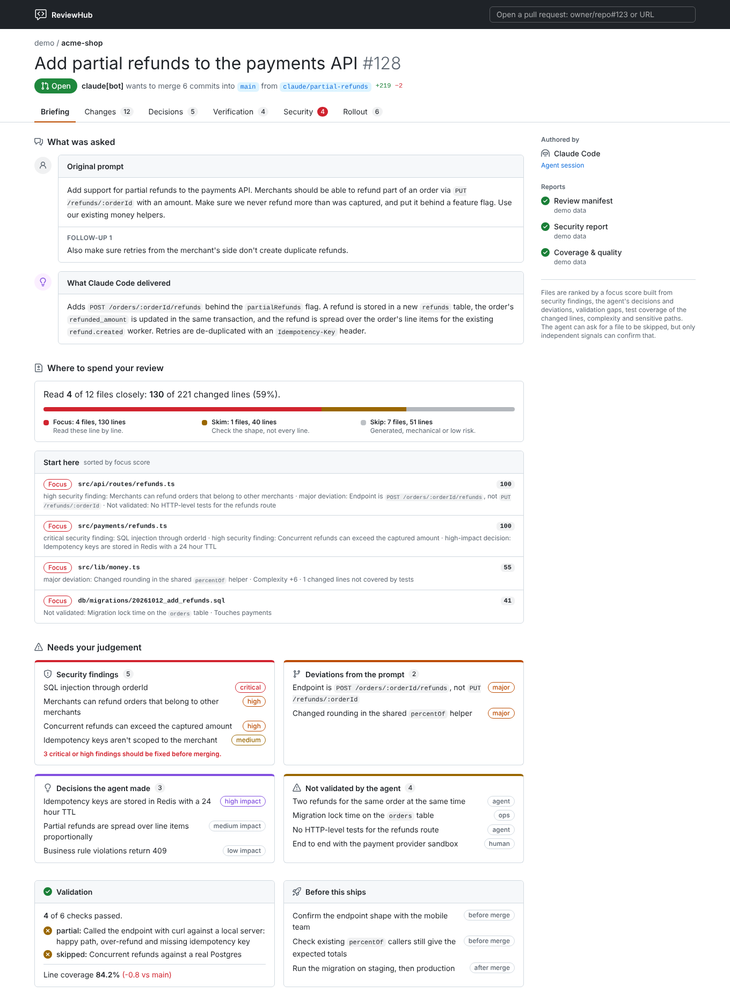

# ReviewHub

Review agent-authored pull requests by what matters, not by line count.

Agents produce more code than people can read line by line, and much of it doesn't need reading. ReviewHub puts three reports next to the GitHub diff and shows a reviewer only what needs their judgement:

- **The ask:** the user's original prompt and follow-ups, next to what was delivered.
- **Deviations:** where the agent did something other than what was asked, and why.
- **Decisions:** questions the prompt left open, what the agent chose, and alternatives with ready-to-run prompts.
- **Validation:** what the agent ran to prove the change works, with evidence.
- **Gaps:** what the agent couldn't validate, and how to close each gap.
- **Rollout:** what humans or other agents still need to do to ship.
- **Security:** findings from a separate agent, each with a patch to apply or a prompt to hand to an agent.
- **Focus ranking:** coverage of the changed lines, complexity, risk signals and the reports above rank every file as *Focus*, *Skim* or *Skip*, so the diff opens on the files that matter and collapses the rest.

Nothing runs on a server. ReviewHub is a Chrome extension, a static web app on GitHub Pages, a briefing comment on each pull request, and a Claude Code plugin; they all talk to GitHub directly.

## TL;DR

Set up a repository: run this in its root, then commit the files it lists. Claude Code then publishes a review manifest with every pull request it opens, and each pull request gets a briefing comment.

```sh
curl -fsSL https://raw.githubusercontent.com/wearethefoos/ReviewHub/main/install.sh | sh -s -- init
```

Then review pull requests wherever you are:

| Where | How |
| --- | --- |
| Claude Code | `/plugin marketplace add wearethefoos/ReviewHub`, then `/plugin install reviewhub@reviewhub`, then `/reviewhub:review owner/repo#123` |
| Chrome | Install [ReviewHub from the Chrome Web Store](https://chromewebstore.google.com/detail/reviewhub/eoejgblmpnccaaohifkeajpblaidgnjo); see the [extension guide](docs/extension.md) |
| Phone or any browser | <https://wearethefoos.github.io/ReviewHub/>, or the briefing comment on the pull request |
| Terminal | `reviewhub review owner/repo#123` (installed by the command above) |



## Install

### Chrome extension

Install [ReviewHub from the Chrome Web Store](https://chromewebstore.google.com/detail/reviewhub/eoejgblmpnccaaohifkeajpblaidgnjo). It works in Chrome and other Chromium browsers (Edge, Brave, Arc), and updates itself.

Then:

- Click **Open in ReviewHub** on any pull request on github.com, or the toolbar button while on one.
- For private repositories, and a higher rate limit than GitHub's 60 anonymous requests an hour, add a fine-grained token with read-only *Pull requests* and *Contents* access in the extension's settings. It stays in your browser and is only sent to `api.github.com`.
- The extension's start page has a demo pull request that needs no token.

See [`docs/extension.md`](docs/extension.md) for installing from a release zip instead, the token, what each tab shows and troubleshooting.

### On your phone

- **The briefing comment.** Repositories set up with `reviewhub init` get a workflow that keeps one ReviewHub comment on every pull request: blockers, deviations, decisions, what wasn't validated and which files to read, with links into the diff. It reads well in the GitHub mobile app.
- **The web app** at <https://wearethefoos.github.io/ReviewHub/> is the extension's review page as a static site (the briefing comment links to it). Add it to your home screen. Public repositories work without a token; for private ones, add a token in its settings. The token stays in that browser tab unless you choose to remember it.
- **Claude Code from the Claude app** (cloud sessions) can't install plugins, so `reviewhub init` puts the plugin's skills, subagent and hooks into the repository itself. See [Repository setup](#repository-setup-reviewhub-init).

### Claude Code plugin

```
/plugin marketplace add wearethefoos/ReviewHub
/plugin install reviewhub@reviewhub
```

- `/reviewhub:review owner/repo#123`: a briefing on the pull request in your session, then a walk through what needs your judgement.
- `/reviewhub:security-review owner/repo#123`: an independent security review by a subagent, published as a PR comment.
- `reviewhub:review-manifest`: Claude writes and publishes the manifest for pull requests it opens, in repositories that opt in by mentioning ReviewHub in their `CLAUDE.md` (a hook reminds it after `gh pr create`).

The plugin brings the `reviewhub` CLI with it: on first use it downloads the release binary matching the plugin's version and checks it against the release's `SHA256SUMS`. Updating the plugin updates the CLI. See [`plugin/README.md`](plugin/README.md).

### Repository setup: `reviewhub init`

In a repository you want reviewed with ReviewHub, run this from its root. It installs the `reviewhub` CLI (see [CLI on its own](#cli-on-its-own)) and sets up the repository:

```sh
curl -fsSL https://raw.githubusercontent.com/wearethefoos/ReviewHub/main/install.sh | sh -s -- init
```

Then commit the files it lists. With the CLI already installed, `reviewhub init` does the same.

It writes:

- `.claude/skills/reviewhub-review`, `reviewhub-manifest`, `reviewhub-security-review` and `.claude/agents/reviewhub-security-reviewer.md`: the plugin's skills and subagent, under repository names;
- `.claude/reviewhub/`: a launcher pinned to the CLI version that ran `init`, and the hook scripts;
- hooks in `.claude/settings.json`: at session start the pinned CLI goes on `PATH` (downloaded and checksum-verified on first use); after `gh pr create`, Claude is reminded to publish the manifest;
- a ReviewHub section in `CLAUDE.md`, which opts the repository in;
- `.github/workflows/reviewhub.yml`: the briefing comment (leave it out with `--no-workflow`).

Repository files load in every Claude Code session, including cloud sessions started from the Claude app on your phone, so this works where plugins can't be installed. Run `reviewhub init` again with a newer CLI to update; `reviewhub init --check` exits with 1 when the files are out of date. With the plugin installed too, you'd get both sets of skills; one of the two is enough.

### CLI on its own

For CI, or terminals without Claude Code:

```sh
curl -fsSL https://raw.githubusercontent.com/wearethefoos/ReviewHub/main/install.sh | sh
```

This installs the latest release to `~/.local/bin` (or `$REVIEWHUB_INSTALL_DIR`) after verifying its checksum; set `REVIEWHUB_VERSION=X.Y.Z` for a specific version. Anything after `sh -s --` runs with the installed CLI, as in the `init` one-liner above. Binaries are built for Linux (x86-64, ARM64), macOS (Intel, Apple Silicon) and Windows (x86-64, from Git Bash).

```sh
reviewhub review owner/repo#123            # the briefing: ask, focus files, security, deviations, decisions, gaps
reviewhub review owner/repo#123 --diff     # plus the Focus files' diffs, annotated inline
reviewhub review owner/repo#123 --json     # bundle + focus analysis as JSON, for scripts and agents
reviewhub review --bundle fixtures/demo/bundle.json   # the demo, offline
reviewhub briefing owner/repo#123 [--publish]          # the PR briefing comment: print it, or create/update it

reviewhub schema manifest                                   # JSON Schema to give an agent
reviewhub validate manifest manifest.json                   # exit code 1 with readable errors if invalid
reviewhub metrics --lcov coverage/lcov.info > metrics.json  # coverage report from lcov
reviewhub publish security security.json --repo owner/repo --pr 123   # create or update the PR comment
```

It uses `GITHUB_TOKEN`, or your `gh auth login`.

## How it works

```
authoring agent ──► manifest  ─┐
security agent  ──► security  ─┼─► PR comments (or .reviewhub/*.json) ──► extension / CLI ◄── GitHub diff
CI              ──► metrics   ─┘
```

Each report has its own author, so no agent grades its own work. Reports are only read from people with write access to the repository, the pull request's author, `github-actions[bot]` and logins you choose to trust. See [`docs/reports.md`](docs/reports.md) for the formats and how the focus score is computed.

To set up a repository:

1. Run `reviewhub init` and commit the result: Claude Code then publishes a manifest with every pull request, and the briefing comment keeps reviewers up to date. Other agents can follow [`plugin/skills/review-manifest/SKILL.md`](plugin/skills/review-manifest/SKILL.md).
2. Run an independent security review on each pull request: `/reviewhub:security-review`, or another agent prompted with [`plugin/agents/security-reviewer.md`](plugin/agents/security-reviewer.md).
3. Publish coverage from CI, for example with [`docs/examples/reviewhub-metrics.yml`](docs/examples/reviewhub-metrics.yml).

## Development

```
crates/core/       Rust: report types and validation, GitHub trust rules, diff parsing, focus scoring
crates/cli/        Rust: the reviewhub binary (terminal briefing, publishing, GitHub client)
crates/wasm/       Rust: reviewhub-core compiled to WebAssembly for the extension
extension/         Chrome extension and the web app (Vite, React, Tailwind with GitHub's Primer colours)
plugin/            Claude Code plugin: skills, security-reviewer subagent, hooks, CLI launcher
.claude-plugin/    plugin marketplace (this repository)
schemas/           JSON Schemas, generated from crates/core
fixtures/demo/     the demo pull request
```

All logic lives in `crates/core`. The extension only fetches from GitHub and renders; it calls the same Rust code as the CLI through WebAssembly, with TypeScript types generated from the Rust types.

```sh
# Rust
cargo test --workspace
cargo clippy --workspace --all-targets -- -D warnings
UPDATE_SCHEMAS=1 cargo test -p reviewhub-core schemas                 # after changing report types
cargo test -p reviewhub-core --features ts export_bindings            # regenerate extension/src/generated

# Extension (needs: rustup target add wasm32-unknown-unknown; cargo install wasm-bindgen-cli at the Cargo.lock version)
cd extension && npm ci
npm run wasm && npm run build     # then load extension/dist unpacked
npm run build:web                 # the web app in extension/dist-web (deployed to Pages from main)
npm test && npm run typecheck && npm run lint

# Plugin
claude --plugin-dir ./plugin      # try local changes; set REVIEWHUB_BIN=target/debug/reviewhub to use a local CLI build
scripts/test-plugin-hook.sh && scripts/test-plugin-shim.sh target/debug/reviewhub
```

Commits follow [Conventional Commits](https://www.conventionalcommits.org/); releases are automated with release-please. See [`RELEASING.md`](RELEASING.md).

## License

ReviewHub is open source under the [Apache License 2.0](LICENSE): use it, change it and build on it, including commercially. Everything in this repository stays under that license. A hosted service with more advanced review tooling may be offered separately in the future; it would live outside this repository and not change the terms of anything here.
